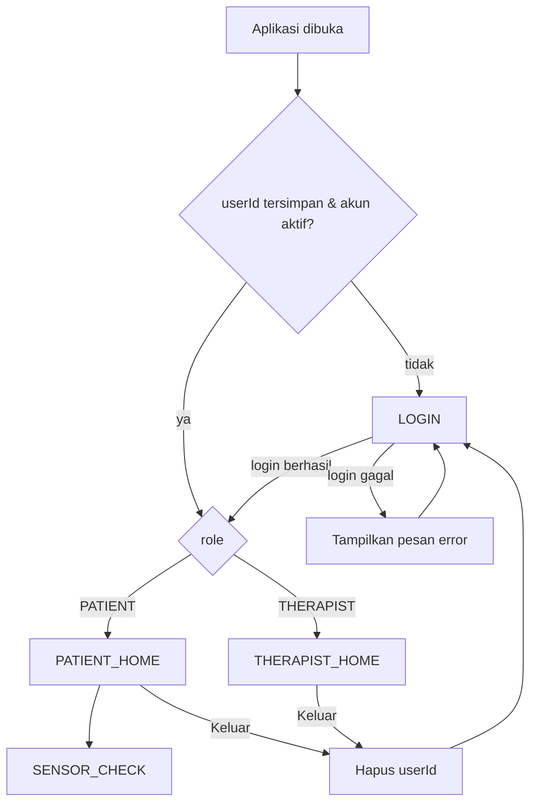

# PGF-ALL-04 — Navigasi & Demo Authentication Berdasarkan Role

### 1. Tujuan
Patient dan Therapist dapat masuk memakai akun demo masing-masing, lalu otomatis diarahkan ke halaman utama sesuai role. Satu role tidak dapat membuka halaman milik role lain.

### 2. Sumber Akun Demo
Akun dibaca dari `app/src/main/assets/mock_data/users.json` (PGF-ALL-03). Folder `mock_data` dipindahkan ke `assets/` agar ikut ter-package ke APK dan dapat dibaca saat runtime.

| Role | Username | Email | Password | Nama |
|---|---|---|---|---|
| THERAPIST | `therapist01` | `therapist@pulihgo.demo` | `demo123` | Demo Therapist |
| PATIENT | `patient01` | `alya@pulihgo.demo` | `demo123` | Alya Putri |
| PATIENT | `patient02` | `bima@pulihgo.demo` | `demo123` | Bima Pratama |

Aturan login:
- Identifier boleh berupa **username atau email**, tidak peka huruf besar/kecil, dan spasi di awal/akhir diabaikan.
- Password **peka huruf besar/kecil**.
- Akun dengan `isActive: false` ditolak.
- Entri dengan `role` di luar `PATIENT`/`THERAPIST` diabaikan oleh parser.
- Yang disimpan di perangkat setelah login (SharedPreferences `pulihgo_auth_session`) **hanya `userId`**, tidak termasuk password. Saat aplikasi dibuka lagi, user langsung diarahkan ke Home sesuai role.

> Ini autentikasi demo, bukan untuk produksi: password ditulis apa adanya di JSON, tanpa hashing dan tanpa token.

### 3. Route & Hak Akses

| Route | Role yang diizinkan | Layar | Task |
|---|---|---|---|
| `LOGIN` | publik | `RoleLoginScreen` | PGF-ALL-04 |
| `PATIENT_HOME` | PATIENT | `PatientHomePlaceholder` → nanti `PatientHomeScreen` (Orie) | PGF-PAT-03 |
| `SENSOR_CHECK` | PATIENT | `SensorCheckScreen` | PGF-SEN-01/02 |
| `THERAPIST_HOME` | THERAPIST | `TherapistHomeScreen` → nanti Dashboard | PGF-THR-02 |

Route didefinisikan di `navigation/AppRoute.kt`. Untuk menambah layar baru, cukup tambahkan entri enum beserta role-nya. Router otomatis menjaga aksesnya.

### 4. Aturan Redirect (`RoleRouter.resolve`)



| Kondisi | Route diminta | Hasil |
|---|---|---|
| Belum login | route ber-role | `LOGIN` |
| Sudah login | `LOGIN` | Home sesuai role |
| Sudah login, role berhak | route tersebut | route tersebut |
| Sudah login, role tidak berhak | route milik role lain | Home sesuai role |

Detail perilaku:
- Login berhasil **mengganti seluruh back stack**, sehingga tombol Back tidak kembali ke layar login.
- Logout menghapus `userId` dan mengembalikan back stack ke `[LOGIN]`.
- Tombol Back sistem menghapus satu layar dari back stack (`BackHandler`). Di layar paling dasar, Back menutup aplikasi.
- Setiap render memanggil `resolve()` lagi. Jika back stack yang dipulihkan berisi route yang tidak sesuai role, user tetap diarahkan ke halaman yang benar.

### 5. Struktur Kode

```
app/src/main/java/com/pulihgo/app/
├── data/model/Models.kt          Role, User, Patient
├── data/MockDataSource.kt        baca assets JSON + MockDataParser (murni, bisa diuji)
├── auth/AuthRepository.kt        login(), findActiveUser(), SessionStore
├── navigation/AppRoute.kt        enum route + RoleRouter (aturan redirect murni)
├── navigation/AppNavigation.kt   back stack + rendering layar
└── ui/auth | ui/patient | ui/therapist
```

Navigasi sengaja tidak memakai library Navigation Compose. Polanya `enum` + `when`, sama dengan branch `feature/orie-ui`, sehingga penggabungannya mudah.

### 6. Integrasi dengan Branch `feature/orie-ui`
1. `DemoAuthRepository` (akun `patient@pulihgo.demo`) diganti dengan `AuthRepository`. `LoginScreen` Orie tetap bisa dipakai karena login dengan email didukung. Di callback `onLogin`, panggil `auth.login(email, password)`, kembalikan `Failure.message` atau null, lalu `resetTo(RoleRouter.homeFor(user.role))`.
2. Isi `PatientRoute` milik Orie (ONBOARDING, REGISTER, FORGOT, LINK_SENT, SETTINGS, …) dipindahkan ke `AppRoute`. Route sebelum login diberi `emptySet()` (publik), sedangkan SETTINGS dan HOME diberi `setOf(Role.PATIENT)`.
3. Di `AppNavigation`, `PatientHomePlaceholder` diganti dengan `PatientHomeScreen` milik Orie. Hubungkan tombol mulai latihan ke `SENSOR_CHECK` (atau ke Exercise Preparation PGF-PAT-04).
4. Register Orie hanya tersimpan di memori. Akun hasil register perlu dimasukkan ke daftar `AuthRepository` dengan `Role.PATIENT` agar bisa login di sesi yang sama.

### 7. Pengujian
Unit test di `app/src/test/java/com/pulihgo/app/auth/RoleAuthTest.kt`:
- `MockDataParserTest`: `users.json` dan `patients.json` asli terbaca, relasi user↔patient↔therapist valid, role tidak dikenal dilewati.
- `AuthRepositoryTest`: login per role, login dengan email dan identifier case-insensitive, password salah, field kosong, akun nonaktif.
- `RoleRouterTest`: tujuan Home per role, tamu diarahkan ke login, role tidak bisa membuka layar role lain, setiap route ber-role punya pemilik.

Uji manual: login `therapist01/demo123` → Therapist Home menampilkan 2 pasien (P001, P002). Logout, lalu login `patient01/demo123` → Patient Home. Tutup aplikasi lalu buka lagi → tetap di Home tanpa login ulang.
