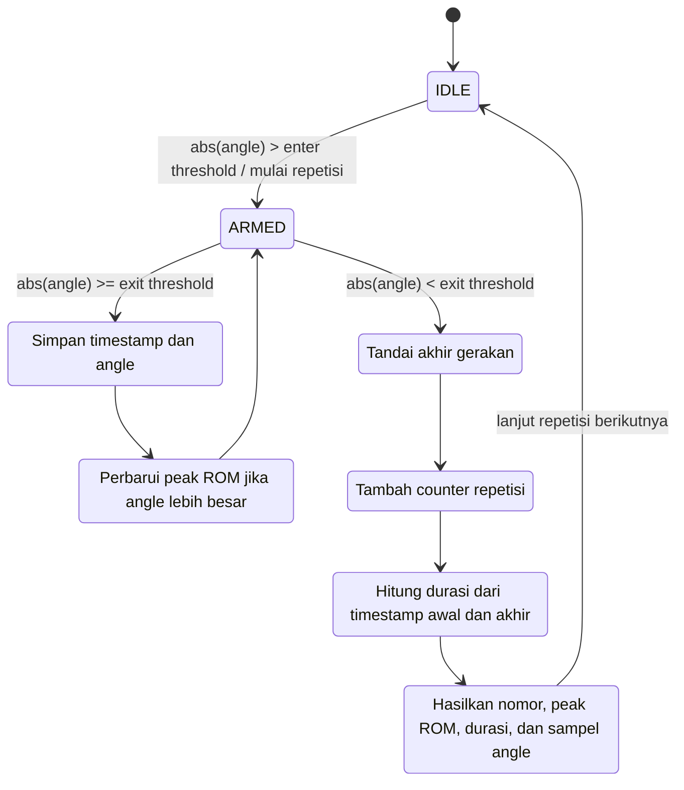

# PGF-REP-01 — Repetition Detection Rules & State Machine

### 1. Tujuan
Mendefinisikan aturan deteksi dan penghitungan repetisi berdasarkan perubahan sudut gerakan yang telah dikalibrasi.

### 2. Definisi Repetisi
Satu repetisi didefinisikan sebagai satu siklus pergerakan yang dimulai ketika sudut gerakan melewati ambang masuk (*enter threshold*) dan diselesaikan ketika sudut kembali melewati ambang keluar (*exit threshold*) menuju posisi netral.

### 3. State Machine
Sistem menggunakan dua state utama:

- **IDLE:** Menunggu sudut gerakan melewati enter threshold.
- **ARMED:** Gerakan telah terdeteksi. Sistem mengumpulkan sampel sudut dan melacak sudut maksimum hingga gerakan kembali melewati exit threshold.
- **Proses internal:** State tambahan berikut menjelaskan langkah pemrosesan selama dan setelah `ARMED`.

### 4. Aturan Deteksi

1. Sistem menerima data sudut hasil kalibrasi secara berkala.
2. Sistem membandingkan nilai absolut sudut dengan enter threshold.
3. Jika sudut melewati enter threshold, sistem berpindah dari IDLE ke ARMED dan mulai menyimpan sampel gerakan.
4. Selama ARMED, sistem menyimpan sampel dan memperbarui nilai sudut maksimum.
5. Jika sudut kembali berada di bawah exit threshold, sistem menyelesaikan satu repetisi.
6. Sistem menambahkan counter sebanyak satu, menghitung durasi gerakan, dan menghasilkan data repetisi.
7. Sistem kembali ke IDLE untuk mendeteksi repetisi berikutnya.

### 5. Parameter Threshold

Threshold dapat ditentukan berdasarkan target ROM latihan:

- Enter Threshold = Target ROM × 0,45.
- Exit Threshold = Target ROM × 0,10.

Sebagai contoh, dengan target ROM 70°, enter threshold adalah 31,5° dan exit threshold adalah 7°.

Apabila target ROM tidak diberikan, implementasi baseline menggunakan nilai default enter 40° dan exit 15°.

### 6. Kriteria Repetisi Terhitung

Repetisi dihitung apabila:

1. Sudut telah melewati enter threshold.
2. Sistem telah memasuki state ARMED.
3. Sudut kembali melewati exit threshold.

#### Catatan:
Pasien yang belum mampu mencapai ROM target tetap bisa memperoleh catatan jumlah gerakan yang berhasil dilakukan selama memasuki kondisi ARMED. Sementara itu, kekurangan jangkauan geraknya tetap terlihat dari nilai ROM yang tercatat. Hal ini relevan dalam rehabilitasi karena kemampuan pasien bisa meningkat secara bertahap, jadi gerakan yang belum mencapai target tetap dapat menjadi data perkembangan.

### 7. Output

Setiap repetisi yang selesai menghasilkan:

- Nomor repetisi.
- Sudut maksimum (peak ROM).
- Durasi repetisi.
- Sampel sudut selama repetisi.

Data tersebut dapat digunakan oleh fungsi penghitungan ROM dan evaluasi smoothness.
