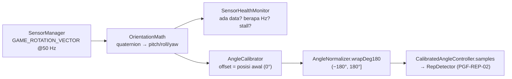

# PGF-SEN-01 & PGF-SEN-02 — Cek Sensor, Kalibrasi, dan Normalisasi Sudut

### 1. Alur Data



Padanan dengan repo asli: `useDeviceAngle.ts` → `DeviceAngleSensor`, `useCalibratedAngle.ts` → `AngleCalibrator` + `AngleNormalizer`.

### 2. PGF-SEN-01 — Cek Sensor
**Pemilihan sensor** (urutan prioritas, yang pertama tersedia dipakai):

| Prioritas | Sensor | Keterangan |
|---|---|---|
| 1 | `TYPE_GAME_ROTATION_VECTOR` | Fusion gyro + accel oleh OS, tanpa magnetometer sehingga tidak terganggu logam. Padanan `DeviceMotion` di Expo. |
| 2 | `TYPE_ROTATION_VECTOR` | Ditambah magnetometer; yaw bisa terganggu logam. |
| 3 | `TYPE_ACCELEROMETER` | Mode terbatas: hanya pitch/roll dari gravitasi, tanpa yaw, dan berisik saat bergerak. UI menampilkan peringatan. |

Sensor dibaca di 50 Hz (`20 000 µs`), sama dengan `updateMs = 50` di repo asli.

**Izin:** di Android, sensor gerak **tidak memerlukan runtime permission** (izin `HIGH_SAMPLING_RATE_SENSORS` baru dibutuhkan di atas 200 Hz). Karena itu, kondisi gagal yang ditangani adalah:

| Status (`SensorHealth`) | Kapan | Yang ditampilkan |
|---|---|---|
| `Unavailable` | Tidak ada satu pun sensor di atas | Latihan tidak dapat diukur |
| `RegistrationFailed` | `registerListener` mengembalikan false | Minta tutup aplikasi lain, lalu coba lagi |
| `WaitingFirstSample` | Baru terdaftar, < 2 detik | "Menghubungkan sensor…" |
| `NoData` | > 2 detik tanpa sampel pertama | Minta mulai ulang aplikasi/perangkat |
| `Stalled` | Data pernah masuk lalu berhenti > 1 detik | Lama berhenti; pulih otomatis bila data kembali |
| `Streaming` | Normal | Frekuensi aktual (Hz) |

Selain itu, akurasi `UNRELIABLE`/`LOW` dari `onAccuracyChanged` memunculkan saran kalibrasi ulang. Tombol **Kalibrasi** hanya aktif saat status `Streaming`.

Listener hanya aktif saat layar terlihat (`repeatOnLifecycle(STARTED)`) dan dilepas saat aplikasi masuk background, supaya tidak menguras baterai.

### 3. PGF-SEN-02 — Kalibrasi
1. Pasien menahan posisi netral: siku menempel di badan dan ditekuk 90°, ibu jari menghadap ke atas.
2. Tekan **Kalibrasi**. Sistem mengumpulkan **25 sampel (≈0,5 detik)**.
3. Offset = **rata-rata sirkular** per sumbu. Rata-rata biasa salah di batas: mean(179°, −179°) = 0°, padahal yang benar 180°.
4. Jika ada sampel yang menyimpang **> 4°** dari rata-rata, kalibrasi ditolak (`FailedUnstable`) dan pasien diminta menahan lengan tetap diam.
5. Setelah berhasil: `relative = wrapDeg180(raw − offset)`, sehingga posisi awal = 0°.

Perilaku tambahan:
- Kalibrasi ulang yang gagal **tetap memakai offset lama**, jadi angka tidak tiba-tiba lompat.
- Offset disimpan di `rememberSaveable` sehingga tidak hilang saat layar diputar.
- **Reset** menghapus offset; nilai yang ditampilkan kembali ke nilai mentah yang dinormalisasi.

### 4. PGF-SEN-02 — Normalisasi ±180°
`wrapDeg180(deg)` memetakan nilai apa pun ke **(−180°, 180°]**. Ini modulo wrap, bukan clamp, jadi tidak ada data yang dibuang.

| Input | Output |
|---|---|
| 190 | −170 |
| −190 | 170 |
| −180 | 180 |
| 540 | 180 |
| 340 | −20 |

Contoh nyata: posisi awal roll mentah = −170°, lalu pasien memutar −30°. Sensor membaca 160° karena sudah ter-wrap. Tanpa normalisasi: 160 − (−170) = **330°**, yang salah. Dengan normalisasi: **−30°**, yang benar.

### 5. Kontrak untuk Modul Lain
```kotlin
val controller = CalibratedAngleController(source, updates = { sensor.updates() }, clockMs = SystemClock::elapsedRealtime)
// collect di dalam repeatOnLifecycle(STARTED) { controller.run() }

controller.samples.collect { s ->          // ~50 Hz, sudah dikalibrasi dan dinormalisasi
    repDetector.push(s.angle(Axis.ROLL), s.elapsedMs)   // PGF-REP-02 (Erza)
}
controller.state                           // StateFlow<SensorUiState>, untuk Live Exercise (PGF-SEN-03)
```
- Sumbu latihan Forearm Supination/Pronation = **`Axis.ROLL`**, sama dengan `exerciseLibrary.ts` di repo asli.
- Satuan derajat, rentang (−180°, 180°]. Waktu dalam ms dari `SystemClock.elapsedRealtime()` (monotonic).
- Sebelum kalibrasi, `samples` tetap mengalir dengan offset 0. Live Exercise sebaiknya mewajibkan status `Calibrated` sebelum mulai menghitung.

### 6. Pengujian
Unit test (`app/src/test/java/com/pulihgo/app/sensor/`):
- `AngleNormalizerTest`: wrap di semua batas, sudut relatif melewati ±180°, rata-rata sirkular, jarak sudut.
- `AngleCalibratorTest`: posisi awal = 0°, kalibrasi di batas ±180°, penolakan saat bergerak, offset lama dipertahankan, reset.
- `OrientationMathTest`: quaternion → roll/pitch sesuai konvensi `SensorManager.getOrientation`, rotation vector 3 nilai, fallback gravitasi konsisten dengan rotation vector.
- `SensorHealthMonitorTest`: NoData, frekuensi 50 Hz, deteksi stall dan pemulihan.
- `CalibratedAngleControllerTest`: alur end-to-end dari pembacaan, kalibrasi, sampai sudut relatif melewati ±180°.

Uji perangkat (masuk PGF-INT-04): buka **Cek Sensor & Kalibrasi**, pastikan status "Sensor terhubung ~50 Hz", lalu kalibrasi. Roll harus ≈ 0°, supinasi menghasilkan nilai positif atau negatif yang konsisten, dan nilai tidak lompat saat melewati ±180°.
